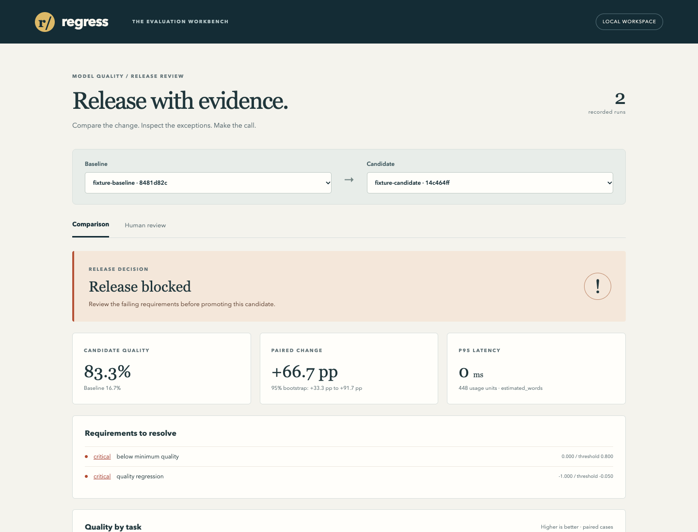

# Regress · LLM Regression Workbench

A local evaluation service, Python SDK and browser workspace for deciding whether a prompt or model change is safe to release. Compare paired cases, investigate failed task slices, collect blinded reviewer preferences and enforce the same decision in CI.



## Run the complete demo

Requires Python 3.10 and Node 16.16. The core service has no Python dependencies.

```sh
python3 scripts/demo.py
cd frontend
npm ci
npm run build
cd ..
python3 -m regression_workbench.cli serve --policy fixtures/gate-policy.json
```

Open **http://127.0.0.1:8765**. The included candidate improves aggregate fixture accuracy from 16.7% to 83.3%, but fails every critical case. The release stays blocked. Click a failed slice to inspect its examples, then open **Human review** to label responses without model names.

The fixture provider uses deliberately authored outputs for repeatable demonstrations. It does not claim to be a model benchmark. Actual FLAN-T5 measurements are reported below.

## What the workbench does

- Versioned task datasets and prompt/model configuration with content-derived run identities.
- Extraction field accuracy; a documented JSON-schema subset; constrained summary keyword coverage; tool name and argument checks.
- Paired baseline/candidate comparisons, task and named-slice metrics, seeded bootstrap intervals and required critical-slice gates.
- Exact or explicitly estimated usage accounting, latency percentiles and provider-error budgets.
- Blinded A/B review, ties and skips, optimistic edit conflicts, human/judge disagreement and calibration-set tie-threshold selection.
- Recursive credential redaction before SQLite persistence, bounded durable retries, fenced worker leases, resumable results and consistent backups.
- CLI exit codes, JSON/Markdown reports, a React workspace, automated tests and a small container image.

SQLite is the supported storage engine. This is a trusted local workspace: reviewer names identify labels, not authenticated accounts. HTTP mutations require same-origin JSON; the service defaults to loopback. This repository does not implement multi-user access control or a PostgreSQL backend.

## Evaluate your own candidate

```sh
python3 -m regression_workbench.cli validate fixtures/tasks-v1.json
python3 -m regression_workbench.cli run fixtures/tasks-v1.json \
  --config fixtures/baseline-config.json \
  --outputs fixtures/baseline-outputs.json
python3 -m regression_workbench.cli list
python3 -m regression_workbench.cli compare BASELINE_RUN_ID CANDIDATE_RUN_ID \
  --policy fixtures/gate-policy.json --markdown .local/release-report.md
```

`compare` exits **0** for a passing gate, **1** for a blocked release and **2** for invalid input or an operational error. Different dataset fingerprints and incomplete runs cannot be compared. SDK providers implement `generate(prompt, case, config) -> Response`; see [SDK and data contracts](docs/contracts.md).

## Reproduce actual local-model results

Use a separate Python 3.10 environment for the optional CPU inference dependencies:

```sh
python3 -m venv .local/inference
.local/inference/bin/pip install -r requirements-inference.txt
python3 scripts/fetch_model.py
.local/inference/bin/python scripts/measure_model.py \
  --model-path .local/models/flan-t5-small \
  --revision 371f99f1df1429771f01227c93bd662f5eec2480
```

The downloader verifies the exact size and SHA-256 of six pinned public artifacts. Weights are approximately 308 MB and are not checked into this repository.

Three actual CPU runs covered 24 owned cases each: two baseline repetitions and one candidate prompt. Both baseline repetitions produced identical outputs. Baseline mean score was **0.0625**, candidate **0.0417**; JSON extraction, schema and tool tasks scored zero, while summary scores were **0.25 → 0.1667**. The candidate was blocked. Total generation/evaluation wall time was **7.92 seconds** on arm64 with two Torch threads; model loading is excluded. These small-model limitations are retained in [the measurement record](evidence/flan-t5-small.json), not converted into an unsupported success claim.

The judge used for review analysis is the deterministic task evaluator, not an LLM judge. Browser walkthrough labels demonstrate the workflow; they are not an independent human study. Calibration-set agreement is not held-out accuracy.

## Verify and operate

```sh
python3 -m unittest discover -s tests
cd frontend
npm test
npm run build
npx playwright install chromium
# Start the demo service in another terminal first.
npm run test:e2e
```

For an existing Chrome installation, set `CHROME_PATH` before the browser command. Tests cover a real killed worker, two competing SQLite reviewers, HTTP origin protection and a mobile layout.

See [architecture](docs/architecture.md), [operating and recovery instructions](docs/operations.md), [measurement boundaries](docs/verification.md) and [third-party notices](THIRD_PARTY_NOTICES.md).
