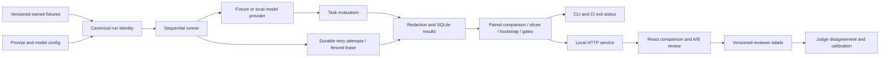

# Architecture and decisions

The core uses the Python standard library so fixture evaluation, CI gates and reports run without model packages or a remote service. Optional inference is isolated behind a provider contract. The frontend is a separately built static bundle served from the same origin as the API.

SQLite uses WAL and foreign keys. Run claims are conditional updates; owner and expiration checks fence result writes. A short `BEGIN IMMEDIATE` transaction serializes the ownership check and result insert. Reviews similarly acquire an immediate transaction before testing their expected revision, preventing lost updates across independent HTTP connections.

Immutable result keys guarantee one persisted observation per case and run. They do not guarantee exactly one external provider invocation: a process can die after receiving a response but before persisting it. Providers with side effects must use their own idempotency contract; this workbench is designed for read-only evaluation calls.

A worker renews its lease before each case. Set its lease longer than a provider's maximum request duration. Expired workers cannot write. There is no background heartbeat or hard cancellation of an in-process Transformers generation.

Configuration rejects credential-bearing keys. Structured traces and free text pass through redaction before storage; pass known secret values explicitly through `Store(secrets=...)` when integrating a provider. Heuristic token/key patterns cannot recognize every possible secret. Keep real credentials and sensitive customer fixtures out of version control.

We use paired cases rather than unrelated aggregate runs. A critical slice can block release even when the aggregate improves. The UI connects gate findings to concrete examples. Human preferences remain separate observations with stable blinding, conflict checks and transparent disagreement reporting.
